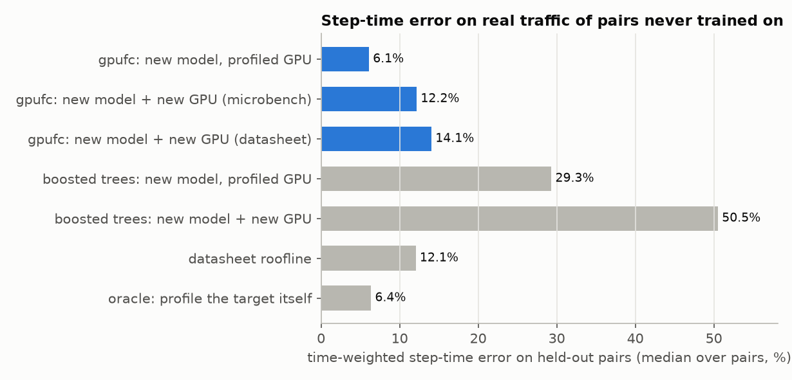
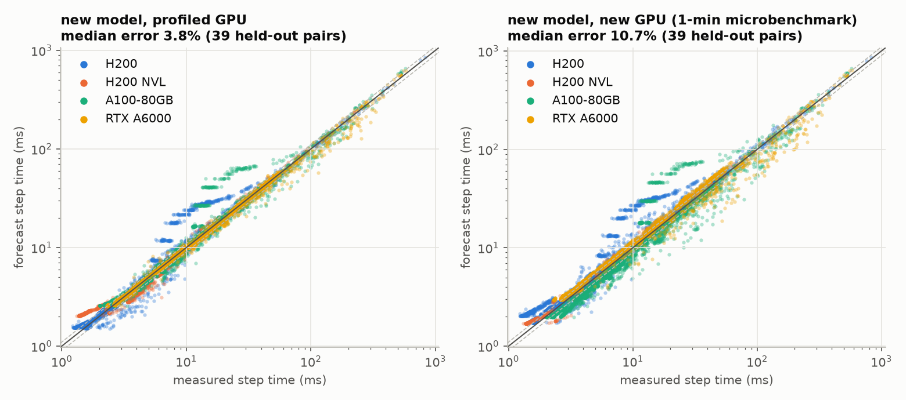
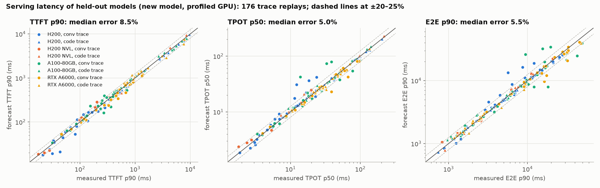
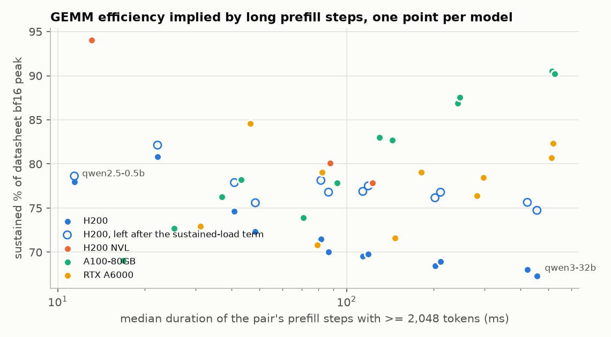

# gpufc: forecast LLM serving performance on models and GPUs you have not profiled

`gpufc` answers capacity-planning questions before you have the hardware or have run the
model: *what TTFT and TPOT will Qwen3-14B give on an A100 at 6 req/s of chat traffic, what
is the highest rate that still meets a 1 s TTFT target, and how many GPUs of each type
does 100 req/s need?*

It does this with a physically structured step-time model (roofline terms computed from
the model's `config.json` and the GPU's datasheet, weighted by efficiencies learned on
*other* models and GPUs), a KV-cache size model, and
[batchsim](https://github.com/Abhayrkhot/Continuous-Batching-Simulator)'s exact
re-implementation of vLLM's scheduler to turn step times into per-request latency.

Everything below is measured: 39 (model, GPU) pairs, 13 Qwen models
from 0.5B to 32B (dense and a 30B mixture-of-experts) on H200, H200 NVL, A100-80GB, RTX A6000, served by vLLM 0.34,
1,517,710 engine steps timed with CUDA events inside the engine, and 193 replays of
the Azure LLM inference traces (121,361 requests). Every forecast is scored on a pair
the forecaster never saw.

## Results

| method | setting | pairs | median error | time-weighted | p90 error |
| :--- | :--- | ---: | ---: | ---: | ---: |
| **gpufc** | new model, profiled GPU | 39 | 3.8% | 6.1% | 8.2% |
| gradient-boosted trees | new model, profiled GPU | 39 | 22.0% | 29.3% | 39.1% |
| **gpufc** | larger model (fit on <=8B), profiled GPU | 12 | 3.2% | 4.6% | 5.9% |
| **gpufc** | profiled model, new GPU (microbenchmark) | 39 | 11.3% | 11.9% | 15.8% |
| **gpufc** | new model, new GPU (1-min microbenchmark) | 39 | 10.7% | 12.2% | 16.6% |
| **gpufc** | new model, new GPU (datasheet) | 39 | 13.3% | 14.1% | 20.0% |
| gradient-boosted trees | new model, new GPU (datasheet) | 39 | 49.4% | 50.5% | 60.7% |
| datasheet roofline | hand-set weights, no fit | 39 | 13.8% | 12.1% | 19.3% |
| oracle (profile the target) | target profiled | 39 | 1.6% | 6.4% | 7.2% |

*Step-time error on the real-traffic steps of held-out (model, GPU) pairs: median over
pairs of the per-pair median and time-weighted absolute error. "Time-weighted" weights
each step by its duration, which is what end-to-end latency depends on. The datasheet
roofline is the same step model at hand-set weights (about 60-70 % of peak, 1.5 ms of
host time per step), with nothing fitted.*

- **New model on a profiled GPU:** 6.1% time-weighted error, against
  6.4% for a model calibrated on the target pair itself (the "oracle": what
  you get by profiling the target) and 12.1% for the datasheet roofline.
- **Larger model than any trained on:** fitted only on models up to 8B, the forecast for
  the 12 larger pairs is 4.6% off.
- **New model on a GPU never run:** 12.2% with a one-minute microbenchmark of the
  GPU (a large GEMM and a device copy), 14.1% from the datasheet alone. That is
  no better than the roofline overall; [New GPUs](#new-gpus) below breaks it down and
  explains why. Gradient-boosted trees trained on the same pairs reach 29.3% on
  a profiled GPU and 50.5% on a new one: without the roofline structure they
  do not extrapolate.





### Serving latency

Each held-out pair's Azure-trace replays are simulated with the forecast step model,
the *forecast* KV-cache size, and a frontend latency learned on other pairs, using the
send times the client actually recorded. Median absolute error across replays:

| method | setting | replays | TTFT p50 | TTFT p90 | TPOT p50 | TPOT p90 | E2E p50 | E2E p90 |
| :--- | :--- | ---: | ---: | ---: | ---: | ---: | ---: | ---: |
| **gpufc** | new model, profiled GPU | 176 | 8.6% | 8.5% | 5.0% | 5.4% | 5.2% | 5.5% |
| **gpufc** | larger model (fit on <=8B), profiled GPU | 54 | 6.1% | 9.1% | 5.1% | 7.4% | 5.7% | 5.0% |
| **gpufc** | profiled model, new GPU (microbenchmark) | 176 | 11.5% | 10.2% | 9.5% | 10.5% | 10.3% | 10.4% |
| **gpufc** | new model, new GPU (1-min microbenchmark) | 176 | 11.5% | 10.2% | 11.8% | 10.9% | 11.6% | 11.1% |
| **gpufc** | new model, new GPU (datasheet) | 176 | 11.3% | 13.0% | 12.3% | 10.1% | 11.8% | 11.6% |
| datasheet roofline | hand-set weights, no fit | 176 | 10.9% | 12.4% | 12.2% | 9.9% | 12.3% | 10.5% |
| oracle (profile the target) | target profiled | 176 | 9.2% | 7.6% | 4.3% | 6.1% | 6.2% | 6.9% |

13 of the new-model replays are left out of this table because no engine model
can explain them: even the oracle, with this pair's own step times and exact KV-cache
size, misses their median TTFT by more than half. They are small models at the highest
request rates (qwen2.5-0.5b on A100-80GB, qwen2.5-0.5b on H200, qwen2.5-0.5b on RTX A6000, qwen2.5-1.5b on A100-80GB, qwen2.5-1.5b on H200, qwen2.5-1.5b on RTX A6000, qwen2.5-3b on A100-80GB, qwen2.5-3b on RTX A6000, qwen3-0.6b on RTX A6000, qwen3-4b on A100-80GB, qwen3-4b on RTX A6000), where the latency is made in vLLM's API server
and the client, not on the GPU.



Forecast and measurement agree on whether a replay meets an SLO of TTFT p90 <= 1 s and
TPOT p90 <= 50 ms in 94% of replays for new models on profiled GPUs and
90% for new GPUs (microbenchmark tier).

### Per GPU and per model

New model, profiled GPU, by GPU:

| GPU | held-out models | step error | oracle step error | TTFT p90 error | TPOT p50 error | oracle TPOT p50 |
| :--- | ---: | ---: | ---: | ---: | ---: | ---: |
| H200 | 13 | 3.6% | 2.0% | 5.2% | 4.0% | 6.6% |
| H200 NVL | 3 | 16.1% | 1.6% | 13.2% | 6.3% | 6.5% |
| A100-80GB | 13 | 3.5% | 2.6% | 8.8% | 5.6% | 2.7% |
| RTX A6000 | 10 | 3.8% | 1.1% | 9.5% | 5.8% | 4.3% |

Median step-time error for each held-out model (new model, profiled GPU):

| model | H200 | H200 NVL | A100-80GB | RTX A6000 |
| :--- | ---: | ---: | ---: | ---: |
| qwen2.5-0.5b | 12.4% | 38.6% | 13.8% | 3.8% |
| qwen3-0.6b | 3.7% | - | 3.5% | 3.0% |
| qwen2.5-1.5b | 3.6% | - | 2.4% | 1.6% |
| qwen3-1.7b | 5.8% | - | 5.3% | 1.3% |
| qwen2.5-3b | 3.0% | 16.1% | 5.1% | 4.4% |
| qwen3-4b | 4.2% | - | 2.8% | 5.1% |
| qwen2.5-7b | 5.7% | - | 5.1% | 4.3% |
| qwen3-8b | 2.4% | 9.3% | 4.2% | 1.7% |
| qwen3-14b | 2.6% | - | 2.9% | 5.8% |
| qwen2.5-14b | 2.7% | - | 1.2% | 3.8% |
| qwen3-30b-a3b | 83.4% | - | 39.1% | - |
| qwen3-32b | 3.1% | - | 2.1% | - |
| qwen2.5-32b | 1.5% | - | 0.4% | - |

A per-GPU fit is only as good as the models behind it. The H200 NVL was profiled with
three, so each of its forecasts is fitted on two (shrunk towards the fit on all GPUs);
its 0.5B model, whose steps are mostly host time, is forecast from a 3B and an 8B and
misses by the most. The mixture-of-experts model is the other outlier: with no other MoE
in training, its expert weights fall back to the prior (see Limitations).

### New GPUs

Each GPU held out entirely (no model ever run on it, peaks from the one-minute
microbenchmark), against the roofline at its hand-set weights:

| held-out GPU | models | gpufc step error | roofline step error | gpufc TTFT p50 | roofline TTFT p50 | host time per step |
| :--- | ---: | ---: | ---: | ---: | ---: | ---: |
| H200 | 13 | 5.7% | 9.9% | 10.1% | 8.9% | 1.19 ms |
| H200 NVL | 3 | 9.5% | 4.7% | 15.1% | 16.4% | 1.25 ms |
| A100-80GB | 13 | 11.9% | 10.1% | 15.7% | 13.2% | 1.78 ms |
| RTX A6000 | 10 | 14.4% | 21.6% | 9.4% | 11.2% | 1.11 ms |

In step error the fitted forecast is clearly better on the H200 and RTX A6000 and worse
on the A100 and H200 NVL, where the hand-set weights happen to fit; in TTFT each is ahead
on two GPUs. Over all pairs the two are level; the forecast's own error runs from
6% to 16% depending on the GPU and metric.

What a fit on other GPUs cannot know is how the new node differs from them in ways
neither a datasheet nor a GPU microbenchmark shows. Swapping one weight at a time from
the held-out GPU's own fit into the fit on the others shows what each miss is made of
(`results/eval/transfer.json`):

- **A100: host time.** Every vLLM step spends a fixed time on the CPU (scheduling, input
  preparation, sampling bookkeeping): 1.8 ms on the A100 node against
  1.2 ms learned from the others, a property of the node's CPU and software
  stack rather than its GPU (last column above). With its own host weight the
  forecast's −11.1% median error falls to −3.6%.
- **RTX A6000: weight GEMMs.** It runs them at 99% of the peaks its
  microbenchmark measured, the other GPUs at 88% of theirs. With its own
  GEMM weight the +12.2% median error falls to +1.9%.

Profiling a new GPU with models of several sizes moves it into the profiled tier, but as
the H200 NVL shows, a fit on two models is not yet better than the pooled one.

### Uncertainty

Every forecast carries a conformal interval from leave-one-pair-out residuals on the
training pairs. Coverage of the 90 % interval on held-out pairs:

| setting | steps inside 90% interval | replays inside band (TTFT p90, TPOT p50) |
| :--- | ---: | ---: |
| new model, profiled GPU | 85.6% | 88.6% |
| larger model (fit on <=8B), profiled GPU | 80.0% | 82.4% |
| profiled model, new GPU (microbenchmark) | 83.2% | 92.0% |
| new model, new GPU (1-min microbenchmark) | 78.3% | 88.9% |
| new model, new GPU (datasheet) | 68.4% | 84.9% |

The intervals are somewhat too narrow, most of all for a new GPU forecast from its
datasheet: residuals from holding out one of three training GPUs understate how
different the fourth can be.

### KV-cache size

The KV-cache size vLLM will allocate is forecast from the model's shapes and the engine
limits; on models the memory model never saw, the median error is 0.5% (worst
10.9%) over 39 pairs. The latency outside the engine (HTTP, API server,
detokenisation) is a constant fitted on other pairs: 5.9 ms median.

### What the GPUs actually deliver

Solving each long prefill step for the GEMM efficiency it implies shows something a
datasheet roofline cannot: the H200 sustains 78% of its bf16 peak on
qwen2.5-0.5b's 11 ms prefill steps but only 67%
on qwen3-32b's 456 ms ones. The fall happens over the first
hundred milliseconds of a step and then levels off, as it does when a power-limited GPU
brings its clocks down under sustained tensor-core load. The RTX A6000 shows no such fall:
73% on its shortest steps (qwen2.5-0.5b,
31 ms) and 82% on its longest (qwen2.5-14b,
518 ms).

A single efficiency per GPU would average over the H200's fall and get the longest steps,
which make the TTFT of large models, wrong. The step model therefore has a sustained-load
term (below), fitted per GPU like the others; what it leaves unexplained on the H200 is
flat, 75% to 82% across all 12 dense models
(hollow markers).



## Usage

```bash
pip install "gpufc @ git+https://github.com/Abhayrkhot/GPU_Forecasting_Model"

gpufc models                                   # built-in model shapes
gpufc gpus                                     # GPU datasheet catalog
gpufc explain  --model qwen3-14b --gpu l40s --decode 64 --context 2048
gpufc predict  --model qwen3-14b --gpu a100-80g --workload azure-conv --rate 6
gpufc capacity --model qwen3-8b --gpu h200 --workload azure-conv --slo-ttft 1 --slo-tpot 50
gpufc plan     --model qwen2.5-32b --rate 100 --workload azure-conv --slo-ttft 1 \
               --gpus h200,h100-sxm,a100-80g --prices prices.json
```

`--model` takes a built-in name, a Hugging Face id, or any `config.json` of a Llama,
Qwen2, Qwen3, Mistral or Qwen-MoE model. `--gpu` takes a catalog name or the name
`nvidia-smi` prints; add a GPU by writing its datasheet numbers to a JSON file. The
packaged forecasting bundle (`src/gpufc/data/bundle.json`) is fitted on all measured
pairs; `gpufc fit` refits it on yours.

The `azure-*` workloads download the public Azure LLM inference traces (about 1 MB each)
on first use; `synthetic` needs nothing.

## How it works

**Step model.** A vLLM step runs one forward pass over `T` tokens from `S` sequences.
For each weight GEMM `[M, k] @ [k, n]` the model computes the compute time `2Mkn / F` and
memory time `(kn + M(k + n)) b / BW` at datasheet peak; their maximum and minimum, summed
over the layers, are two terms whose weights form a smooth roofline (weight-read bound
for decode, compute bound for long prefills). Routed experts get the same pair of terms
with weight traffic scaled by the expected number of distinct experts the batch touches.
A sustained-load term, the step's GEMM compute time scaled by `min(1, t / 50 ms)`, lets
long compute-bound steps run at a lower efficiency than short ones (it is negligible for
decode). Prefill attention FLOPs, decode KV-cache bytes and elementwise traffic complete
the GPU side; host overheads (per step, per sequence, per token, per prefill chunk, per decode
that shares a step with a prefill, and kernel launches for steps not captured in a CUDA
graph) are terms in fixed time units. The forecast is a non-negative weighted sum.

**Why it transfers.** The GPU terms already carry the model's shapes and the GPU's peak
FLOP/s and bandwidth, so their weights are dimensionless inverse efficiencies, and the host
terms carry neither, so the same weights can be carried to a model or GPU never seen
(how well that works for GPUs is above). Weights are
fitted by non-negative least squares on relative error, each pair weighted equally, and
shrunk towards a physical prior: weights the data cannot separate stay plausible instead
of taking whatever extreme value fits the training GPUs. (An early unregularised fit gave a
bandwidth-scaled logits term a weight of 148 to absorb per-sequence CPU time; on a GPU
with a sixth of the bandwidth that forecast was 79 % too slow.)

**Tiers.** For any GPU not profiled, the weights are fitted on all GPUs, with datasheet
peaks or, better, peaks from a one-minute microbenchmark (`bench/jobtools.py
microbench`). For a GPU that was profiled with other models they are fitted on that GPU
and shrunk towards the fit on all GPUs, so a GPU profiled with two models leans on what
the others showed and one profiled with a dozen follows its own data.

**Intervals.** The ridge strength is chosen per fit by leave-one-pair-out cross-validation
on the training pairs, and the held-out residuals of that cross-validation give the
conformal interval. No target data is used anywhere.

**Serving.** Step times, the forecast KV-cache size and the frontend latency go into
batchsim's vLLM 0.34 scheduler (zero mismatches against vLLM's own scheduler over 500k
steps), which replays a workload and reports per-request TTFT, TPOT and end-to-end
latency, SLO attainment and capacity.

## How the data was measured

`bench/run_combo.sh` serves one model with vLLM 0.34 on one GPU (vLLM's own defaults for
batch limits, `--max-model-len 8192`, no prefix caching) with a probe plugin that records
every engine step's batch composition and CUDA-event time. It replays:

1. a **profile** workload sized from the model's roofline: isolated prefills of 16 to
   8,000 tokens, a decode ladder (1 to 512 simultaneous requests at 256 to 4,096 tokens of
   context), Poisson mixtures at three loads, and a saturated prefill burst;
2. **validation** windows of the Azure LLM inference traces (conversation at 40, 70 and
   90 % of the pair's saturation rate; code, a very bursty trace, at 50 and 85 %).

Forecasts are scored only on the validation steps and replays of held-out pairs. The
saturation rate that places the validation loads is computed in the job from the pair's
own profile run; it affects only which loads were replayed, never a forecast.

Raw runs are compacted into `results/` (`results/steps` per-step tables,
`results/replays` per-request timings, `results/runs` metadata), from which
`scripts/evaluate.py`, `scripts/make_figures.py` and `scripts/build_readme.py` rebuild
every number in this README.

## Reproducing

```bash
pip install -e ".[dev]"
python scripts/evaluate.py --workers 16      # held-out evaluation -> results/eval
python scripts/make_figures.py
python scripts/check_bundle.py --write       # refit the packaged bundle
python scripts/build_readme.py
```

To measure a new pair on a Slurm cluster (vLLM 0.34 Apptainer image, models in the HF
cache):

```bash
MODELS="qwen3-8b qwen2.5-7b" sbatch -p <partition> --gres=gpu:<type>:1 bench/combos.sbatch
LANES="qwen3-8b|qwen2.5-7b" sbatch -p <partition> --gres=gpu:<type>:2 bench/lanes.sbatch
EXPLORER=user@cluster-login scripts/collect.sh   # stream runs back, compact into results/
```

## Limitations

- 4 GPU types (H200, H200 NVL, A100-80GB, RTX A6000): the only ones on the cluster whose driver runs the
  CUDA 13 build of vLLM 0.34 (the H100, L40S, L40, A30, A5000 and A100 PCIe nodes run an
  older driver). Forecasts for other GPUs use the unseen-GPU tier, whose error above is
  measured on these only.
- One GPU per engine (no tensor or pipeline parallelism); a plan scales out with
  independent replicas behind an even load balancer.
- One mixture-of-experts model. With no other MoE in training, a new MoE model's expert
  efficiency falls back to the prior; profile one MoE before trusting MoE forecasts.
- bf16 weights and KV cache, vLLM 0.34's defaults (FlashAttention, chunked prefill,
  async scheduling, CUDA graphs), prefix caching off. Other engines or settings need
  their own profiles.
- Synthetic prompts (random token ids) with fixed output lengths, as the simulator
  models; the router of a MoE may spread random tokens differently from real text.

## Layout

```
src/gpufc/      specs (model/GPU), cost (step model), fit, memory, serving, evaluate, cli
bench/          GPU job scripts, vLLM step probe, replay client
scripts/        collect, evaluate, figures, README and bundle generation
results/        compact measurements and evaluation output
tests/          synthetic ground-truth tests (recover known weights on held-out pairs)
```

This repository previously held a prototype whose TensorRT-LLM and SGLang numbers were
generated from formulas rather than measured; it was replaced by the measured pipeline
above.
